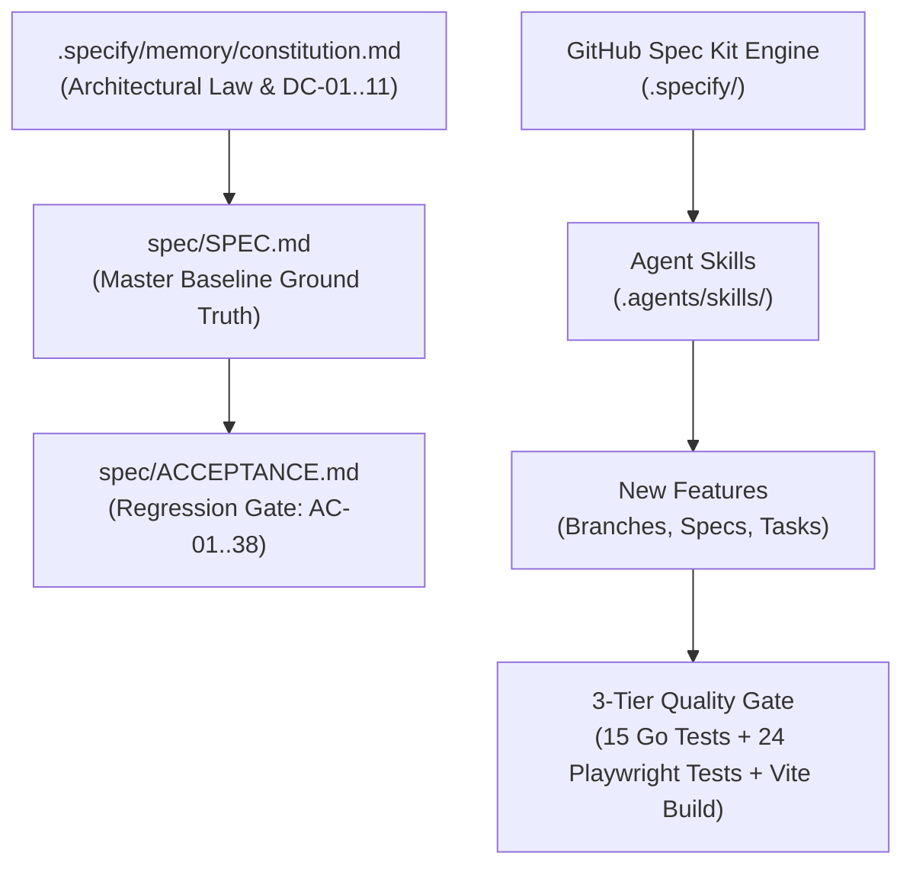
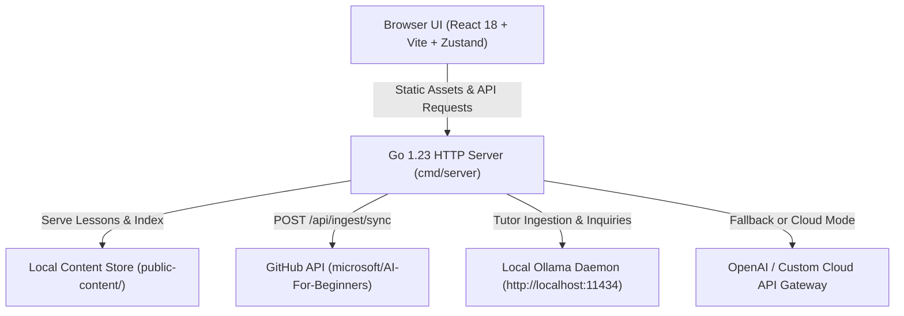

# AI Foundations Coach v3.0

[](https://golang.org)
[](https://react.dev)
[](https://www.typescriptlang.org)
[](https://tailwindcss.com)
[](.specify/)
[](spec/SPEC.md)
[](spec/ACCEPTANCE.md)
[](LICENSE)

A self-paced, interactive AI curriculum platform based on [microsoft/AI-For-Beginners](https://github.com/microsoft/AI-For-Beginners), engineered with **Spec-Driven Development (SDD)** via **GitHub Spec Kit**. It features a grounded, citation-enforced AI teaching assistant, real-time SSE token streaming, interactive comprehension quizzes across all 6 curriculum modules, dark/light theme switching, and live upstream Git curriculum sync.

---

## 📐 Spec-Driven Development & GitHub Spec Kit Integration

In **v3.0**, the repository adopts [GitHub Spec Kit](https://github.com/github/spec-kit) (`specify init`) to formalize Spec-Driven Development across human developers and autonomous AI coding agents.



### 1. Project Constitution (`.specify/memory/constitution.md`)
The repository operates under a ratified project constitution that serves as binding law for all code generation:
- **Master Spec Ground Truth:** `spec/SPEC.md` and `spec/ACCEPTANCE.md` form the immutable baseline. No feature or refactor may break baseline requirements without formal amendment.
- **Strict AI Grounding:** Tutor responses must cite `[<lesson title> § <heading>]` or emit the standard fallback.
- **Zero Timeout SSE Streaming:** Streaming responses must use zero-write-deadline controllers (`http.ResponseController`) to prevent socket drops on local LLMs.
- **Architecture Constraints (DC-01..11):** Go 1.23 stdlib `net/http` router only, React 18 + Vite SPA, zero database (static JSON storage), zero Python runtime, and a single-container deployment.
- **Git Discipline (Rule 10):** Explicit file path staging (`git add <file>`); wildcard staging (`git add .`, `git add -A`) is strictly forbidden.

### 2. Spec Kit Agent Skills for Antigravity & Gemini (`.agents/skills/`)
Configured specifically for **Antigravity** (`agy`) and Google **Gemini**, these native agent skills allow coding assistants to execute SDD workflows reproducibly:
- `/speckit-specify`: Scaffolds formal specifications with user stories, functional requirements, and success metrics.
- `/speckit-plan`: Synthesizes technical design plans validated against the Project Constitution.
- `/speckit-tasks`: Decomposes plans into ordered, bite-sized tasks with explicit verification steps.
- `/speckit-implement`: Guides phased code execution with checkpoint validation.
- `/speckit-checklist`: Evaluates deliverables against strict acceptance criteria.
- `/speckit-constitution`: Reviews, updates, and ratifies constitutional rules.

### 3. Workflow Automation Scripts (`.specify/scripts/bash/`)
- `create-new-feature.sh`: Initializes a new feature branch and scaffolds specification templates.
- `setup-plan.sh`: Validates prerequisite specs and sets up technical planning documents.
- `setup-tasks.sh`: Generates dependency-ordered task files from approved plans.
- `check-prerequisites.sh`: Verifies required tooling, branch state, and constitutional alignment.

---

## 🌟 Highlights & Key Features

### 1. Grounded AI Teaching Assistant
- **Strict Citation Enforcement:** Answers must explicitly cite `[Lesson Title § Section]` from lesson content. Uncited or speculative claims are filtered out.
- **Prompt Injection Defense:** Multi-layered system prompts protect curriculum context from manipulation (`NFR-AI-01`, `NFR-AI-03`).
- **Resilient Real-Time Token Streaming:** Server-Sent Events (`text/event-stream`) with zero-write-deadline socket handling ensure streaming never times out during heavy local model inference (`FR-TUT-11`, `FR-UI-12`).

### 2. Dual AI Backend (Local-First or Cloud)
- **100% Local Ollama Support:** Run completely offline with private, free local models like `llama3.2:1b`, `deepseek-r1`, or `phi3` on `http://localhost:11434`.
- **Cloud LLM Support:** Full compatibility with OpenAI (`gpt-4o-mini`, `gpt-4o`) or any OpenAI-compatible API gateway (OmniRoute, vLLM, LM Studio).
- **Adaptive Context Pruning:** Automatically trims prompt contexts to stay within model memory limits (`maxBytes` parameter).

### 3. Extended Comprehension Quiz Engine (`FR-QZ-01..04`)
- **Complete Module Coverage:** 4 rich comprehension questions per lesson across all 6 curriculum modules (24 questions total).
- **Instant Feedback:** Immediate option grading with detailed conceptual rationales.
- **Grounded AI Hints:** "Get AI Hint" provides targeted conceptual clues via the tutor without revealing answers.
- **Scored Results Recap:** Accuracy scoring with a one-click action to mark lessons completed in the progress ledger.

### 4. Color Theme Engine (`FR-UI-15`)
- Seamless toggle between **Dark Mode**, **Light Mode**, and **System Preference**.
- Tested for WCAG AA compliance with contrast ratios exceeding 4.5:1.
- State persists in `localStorage["ai-foundations-theme"]` without page flicker.

### 6. Adaptive Audience Modes (v3.1 In-Flight Pilot — `SPEC-002`)
- **Multimodal Age & Tech-Literacy Tiers:** Decoupled projection layer over canonical curriculum without duplicating content files.
- **Junior Explorer (Ages 8–14):** Guided by mascot **Chip the Robot**, featuring Grade 6 reading level, physical analogies, and vibrant diagrams.
- **Plain English (Non-Tech Adults):** Jargon-free real-world workplace and home analogies with interactive "Jargon Buster" tooltips.
- **Interactive Turing Test Widget:** Playable "Human or Bot?" dual-terminal guessing scenario embedded in Lesson 1.
- **Specification Bundle:** Managed in `specs/002-adaptive-audience-modes/` (`spec.md`, `plan.md`, `tasks.md`, `1-intro.junior.json`, `1-intro.plain-english.json`).

### 5. Curriculum Git Sync & Ingestion (`FR-ING-09`, `FR-SET-05`)
- One-click upstream synchronization from `microsoft/AI-For-Beginners` directly from the Settings Drawer or CLI.
- Automatically parses Markdown lessons, sanitizes HTML, updates `public-content/index.json`, and records the upstream commit SHA.

### 6. Local-First Privacy & Zero Telemetry
- All lesson progress (completed lessons, quiz scores) is stored strictly in client-side `localStorage`.
- Zero tracking cookies, zero analytics scripts, and zero telemetry transmitted to servers (`NFR-SEC-01`, `FR-PRG-02`).
- Content Security Policy (CSP), anti-clickjacking (`X-Frame-Options: DENY`), and strict MIME-type headers enforced on all HTTP responses.

---

## 🏗️ System Architecture



- **Backend:** Go 1.23 standard library `net/http` router, bounded in-memory sliding window rate limiter (10 req/min/IP), panic recovery middleware, and SSE streamer with non-blocking write deadlines.
- **Frontend:** React 18, Vite, TypeScript, Tailwind CSS, Zustand client-side storage, and a customized rehype/remark pipeline that strips scripts, iframe embeds, and dangerous HTML event handlers (`NFR-SEC-05`).
- **Ingestion Pipeline:** Decoupled `internal/ingest` module supporting exponential egress backoff (AC-16) and absolute asset re-routing to `raw.githubusercontent.com`.

---

## 🚀 Quickstart Guide

### Automated Dependency Check
Anyone downloading or cloning this repository can verify all runtimes, modules, and plugins with a single command:
```bash
# Run pre-flight check
./scripts/check-dependencies.sh

# Or install missing dependencies automatically:
./scripts/check-dependencies.sh --install

# Or via npm from the web directory:
npm --prefix web run check:deps
```
See [DEPENDENCIES.md](DEPENDENCIES.md) for detailed module specifications and plugin installation instructions.

### Prerequisites
- [Go 1.23+](https://go.dev/dl/)
- [Node.js 18+](https://nodejs.org/) & `npm`
- (Optional for Readability Auditing) [Python 3.10+](https://python.org/) & `pip install -r scripts/requirements.txt`
- (Optional for Local AI) [Ollama](https://ollama.com/)
- (Optional for Cloud AI) OpenAI API Key

---

### Option A: Running 100% Locally with Ollama (Recommended)

1. **Start Ollama and pull a lightweight model:**
   ```bash
   ollama serve
   # In another terminal:
   ollama pull llama3.2:1b
   ```

2. **Configure environment:**
   Create `.env` in the repository root:
   ```env
   PORT=8080
   CONTENT_DIR=public-content
   AI_BASE_URL=http://localhost:11434/v1
   AI_MODEL=llama3.2:1b
   AI_MAX_BYTES=1500
   ```

3. **Start the application:**
   ```bash
   # Terminal 1: Go Backend
   export $(grep -v '^#' .env | xargs) && go run ./cmd/server

   # Terminal 2: Web Dev Server
   cd web
   npm install
   npm run dev
   ```

4. Open `http://localhost:5173` (or `http://localhost:8080` for the production bundle).

---

### Option B: Running with Cloud OpenAI

1. **Configure environment:**
   Create `.env`:
   ```env
   PORT=8080
   CONTENT_DIR=public-content
   OPENAI_API_KEY="sk-..."
   AI_MODEL=gpt-4o-mini
   ```

2. **Start the Go server:**
   ```bash
   export $(grep -v '^#' .env | xargs) && go run ./cmd/server
   ```

---

## 📥 Curriculum Ingestion

The application reads pre-processed JSON lesson artifacts from `public-content/`.

### 1. Via User Interface (Settings Drawer)
1. Click the **⚙️ Settings** icon in the header.
2. In the **Curriculum Sync** section, click **Sync Latest**.
3. The server connects to GitHub, parses newest lessons, and updates the curriculum live.

### 2. Via Ingestion CLI
```bash
export GITHUB_TOKEN="<your-github-personal-access-token>"
go run ./cmd/ingest
```

**Pinned Upstream Curriculum Version:**
- Repository: `microsoft/AI-For-Beginners`
- Pinned Commit SHA: `392d0df1b2647cbee104942390551f1ed9e072c8`

---

## 📡 API Reference

All backend endpoints are prefixed with `/api`. Responses strictly conform to JSON standards and include security headers (`X-Content-Type-Options`, `X-Frame-Options`, `Content-Security-Policy`).

| Endpoint | Method | Description |
|---|---|---|
| `/api/health` | `GET` | Exact status check returning `{"ok":true}` |
| `/api/lessons` | `GET` | Returns curriculum index with pinned commit SHA and lesson metadata |
| `/api/lessons/{id}` | `GET` | Returns lesson detail with parsed blocks (markdown, code, image, notebook) |
| `/api/tutor` | `POST` | Ask grounded question. Supports JSON responses or SSE streaming with `Accept: text/event-stream` |
| `/api/config/test` | `POST` | Validates AI endpoint latency and model availability |
| `/api/ingest/sync` | `POST` | Triggers background Git curriculum ingestion |

---

## 🧪 Verification & Automated Testing

This repository is governed by **SPEC-001 v3.0.0** and maintains a 100% passing traceability matrix in [spec/ACCEPTANCE.md](spec/ACCEPTANCE.md) and [.specify/memory/constitution.md](.specify/memory/constitution.md).

### Run Go Unit & Security Tests
```bash
go test -v ./...
```
*Executes all 15 unit tests across `cmd/ingest` and `internal/api` verifying citation filtering, prompt injection defense, rate limiting, and panic recovery.*

### Run Playwright End-to-End Tests
```bash
cd web
npm test
```
*Executes all 24 browser automated tests covering the extended 6-module quiz engine, theme persistence, settings configuration, and lesson navigation.*

### Verify Static Code Quality & Security Rules
```bash
# 1. Verify no dangerouslySetInnerHTML in frontend:
! grep -R "dangerouslySetInnerHTML" web/src

# 2. Verify no debug or pprof profiling endpoints in production:
! grep -R "net/http/pprof" internal cmd

# 3. Verify clean git staging (no committed secrets or build outputs):
! git ls-files | grep -E '^(\.env$|public-content|web/dist|web/node_modules|bin/)'
```

### Production Build Verification
```bash
go vet ./... && go build ./...
cd web && npx tsc --noEmit && npm run build
```

---

## 🐳 Docker Deployment

The application compiles into a single multi-stage container running as an unprivileged non-root user (`UID 10001`):

```bash
# Build production image
docker build -t ai-foundations-coach:3.0.0 .

# Run container
docker run -p 8080:8080 \
  -e AI_BASE_URL="http://host.docker.internal:11434/v1" \
  -e AI_MODEL="llama3.2:1b" \
  ai-foundations-coach:3.0.0
```

---

## 📄 Attribution & Licensing

- Curriculum content is derived from [microsoft/AI-For-Beginners](https://github.com/microsoft/AI-For-Beginners) under the [MIT License](https://github.com/microsoft/AI-For-Beginners/blob/main/LICENSE). This project is not affiliated with, sponsored by, or endorsed by Microsoft.
- Application source code and architecture are released under the [MIT License](LICENSE).
