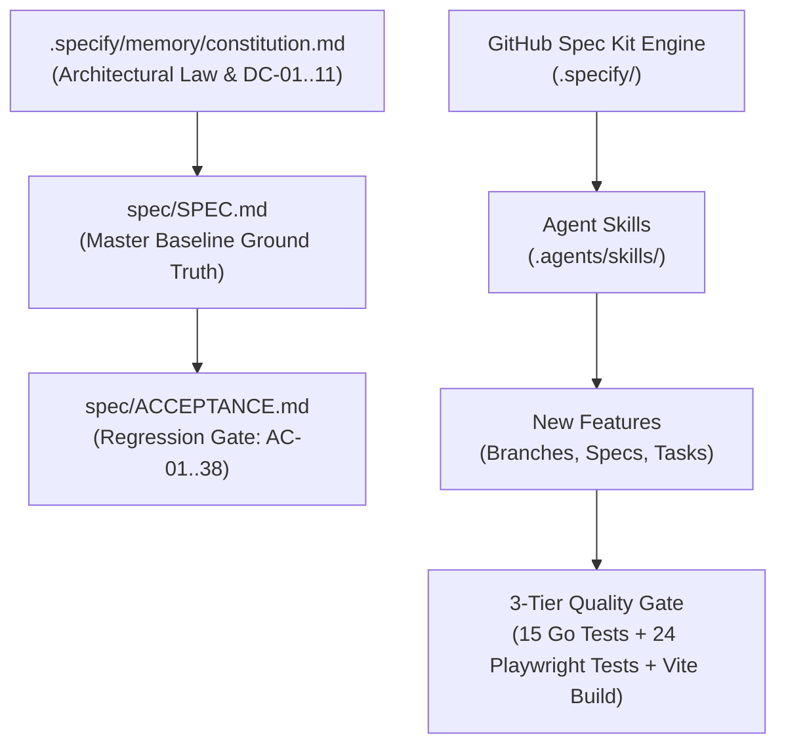
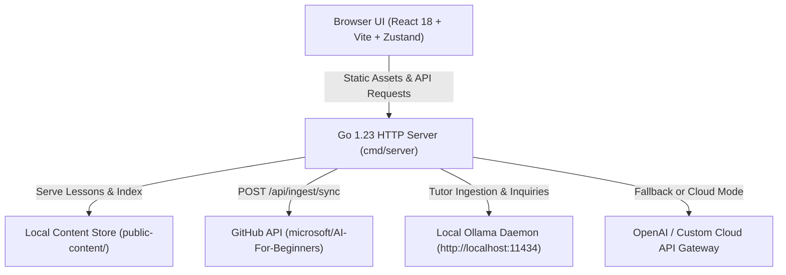

# Spec-Driven Development (SDD) & GitHub Spec Kit Architecture

> **Architectural Law & Engineering Baseline for AI Foundations Coach**  
> Formally established under **SPEC-001 v3.0.0** and governed by [GitHub Spec Kit](https://github.com/github/spec-kit) (`specify init`).

---

## 📐 Overview

**AI Foundations Coach** is engineered using **Spec-Driven Development (SDD)**. Rather than writing ad-hoc code or relying on unverified LLM completions, every capability originates as an unambiguous, testable specification validated against the project constitution before any code is generated or committed.



---

## 📜 1. Project Constitution (`.specify/memory/constitution.md`)

The repository operates under a ratified project constitution that serves as binding law for all code generation:

* **Master Spec Ground Truth:** `spec/SPEC.md` and `spec/ACCEPTANCE.md` form the immutable baseline. No feature or refactor may break baseline requirements without formal amendment.
* **Strict AI Grounding:** Tutor responses must cite `[<lesson title> § <heading>]` or emit the standard fallback. Hallucinations or uncited assertions are strictly forbidden.
* **Zero Timeout SSE Streaming:** Streaming responses must use zero-write-deadline controllers (`http.ResponseController`) to prevent socket drops on local LLMs.
* **Architecture Constraints (DC-01..11):**
  - **DC-01:** Go 1.23 stdlib `net/http` router only (zero third-party web framework dependencies).
  - **DC-02:** React 18 + Vite SPA frontend with TypeScript.
  - **DC-03:** Zero database — static JSON storage for curriculum content (`public-content/`).
  - **DC-04:** Zero Python runtime dependencies for the core application (Python is restricted to auxiliary evaluation scripts).
  - **DC-05:** Single-container deployment footprint.
* **Git Discipline (Rule 10):** Explicit file path staging (`git add <file>`); wildcard staging (`git add .`, `git add -A`) is strictly forbidden to prevent accidental check-ins of secrets, binaries, or untracked cache files.

---

## 🤖 2. Spec Kit Agent Skills (`.agents/skills/`)

Configured specifically for **Google Antigravity** (`agy`), **Claude Code**, and **Gemini**, these native agent skills allow coding assistants to execute SDD workflows reproducibly:

| Skill | Purpose |
|---|---|
| `/speckit-specify` | Scaffolds formal specifications with user stories, functional requirements, and success metrics. |
| `/speckit-plan` | Synthesizes technical design plans validated against the Project Constitution. |
| `/speckit-tasks` | Decomposes plans into ordered, bite-sized tasks with explicit verification steps. |
| `/speckit-implement` | Guides phased code execution with checkpoint validation. |
| `/speckit-checklist` | Evaluates deliverables against strict acceptance criteria. |
| `/speckit-constitution` | Reviews, updates, and ratifies constitutional rules. |

---

## 🛠️ 3. Workflow Automation Scripts (`.specify/scripts/bash/`)

- `create-new-feature.sh`: Initializes a new feature branch and scaffolds specification templates.
- `setup-plan.sh`: Validates prerequisite specs and sets up technical planning documents.
- `setup-tasks.sh`: Generates dependency-ordered task files from approved plans.
- `check-prerequisites.sh`: Verifies required tooling, branch state, and constitutional alignment.

---

## 🏗️ 4. System Architecture



- **Backend:** Go 1.23 standard library `net/http` router, bounded in-memory sliding window rate limiter (10 req/min/IP), panic recovery middleware, and SSE streamer with non-blocking write deadlines.
- **Frontend:** React 18, Vite, TypeScript, Tailwind CSS, Zustand client-side storage, and a customized rehype/remark pipeline that strips scripts, iframe embeds, and dangerous HTML event handlers (`NFR-SEC-05`).
- **Ingestion Pipeline:** Decoupled `internal/ingest` module supporting exponential egress backoff (AC-16) and absolute asset re-routing to `raw.githubusercontent.com`.

---

## 🧪 5. Multi-Tier Verification Gates

Every pull request or release branch must pass the full 3-tier quality gate before merge:

### 1. Go Unit & Security Tests
```bash
go test -v ./...
```
Verifies citation filtering, prompt injection defense, rate limiting, and panic recovery.

### 2. Static Quality & Security Rule Audits
```bash
# Verify no dangerouslySetInnerHTML in frontend:
! grep -R "dangerouslySetInnerHTML" web/src

# Verify no debug or pprof profiling endpoints in production:
! grep -R "net/http/pprof" internal cmd

# Verify clean git staging (no committed secrets or build outputs):
! git ls-files | grep -E '^(\.env$|public-content|web/dist|web/node_modules|bin/)'
```

### 3. TypeScript & Production Build Verification
```bash
go vet ./... && go build ./...
cd web && npx tsc --noEmit && npm run build
```

### 4. End-to-End Browser Regression Suite
```bash
cd web
npm test
```
Executes all automated Playwright tests covering all 6 curriculum modules, 3 adaptive modes, audio personas, and interactive widgets.

---

## 📚 6. Traceability Index

- **Master Specification:** [`spec/SPEC.md`](spec/SPEC.md)
- **Acceptance Criteria & Matrix:** [`spec/ACCEPTANCE.md`](spec/ACCEPTANCE.md)
- **Project Constitution:** [`.specify/memory/constitution.md`](.specify/memory/constitution.md)
- **Feature Specs:**
  - `specs/001-migrating-spec/`: Spec Kit bootstrap and SDD foundation.
  - `specs/002-adaptive-audience-modes/`: 3-tier adaptive audience mode architecture.
  - `specs/spec-improved-graphics.md`: Vector mascots, visual metaphors, and dynamic SVG rendering.
  - `specs/spec-v3.1-curriculum-audio-expansion.md`: Audio Studio 2.0, voice personas, and interactive simulators across all lessons.
