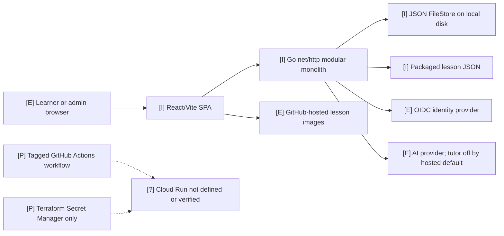

# Current architecture — 2026-11-02

**Evidence basis:** repository inspection; cloud resources and accounts were not inspected. Legend: `[I]` implemented, `[P]` partial, `[E]` external dependency, `[?]` unverified.

| Component | Status | Evidence and limits |
|---|---|---|
| Browser app | Implemented and verified locally | `web/src/App.tsx`, `web/src/pages/`, `web/src/components/`, Playwright suite. React/Vite serves from same Go image in production. Accessibility and performance need field measurement. |
| Auth and admin | Implemented and verified locally | `internal/auth/`, `internal/api/session_gate.go`, `internal/api/admin_handlers.go`; OIDC issuer is external and staging flow is unverified. |
| API and streaming | Implemented and verified locally | `internal/api/router.go`, `internal/api/tutor.go`, `web/src/api.ts:106`; streaming is a POST SSE fetch with abort, but no resume/reconnect in the client. |
| State | Implemented for local/single-instance only | `internal/state/store.go:105`, `filestore.go:80`; `cmd/server/main.go:132` opens a file store in hosted mode. No Firestore adapter found. |
| Usage, spend and feedback | Implemented locally | `internal/usage/`, `internal/spend/`, `internal/feedback/`; usage buffering and worker lifecycle need multi-instance design review. |
| Cost display | Partially implemented | `internal/cost/provider.go:30-40` has a source interface and an explicit “not connected” implementation. No billing adapter. |
| Cloud delivery | Partially implemented | `.github/workflows/deploy.yml`, `deploy/terraform/main.tf`; cloud service, backups and traffic controls absent. No live deployment verified. |

The modular monolith is appropriate for the specified beta. The one-container design is consistent with constitution DC-08. Independent services are not justified by measured load or isolation needs today.

The production build currently emits a large main JavaScript chunk (about 1.62 MB minified) and several large Mermaid-related chunks. This is a measured build artifact, not yet a measured user latency problem; profile low-bandwidth lesson loading before reprioritizing code splitting.

## Important behavior

- Hosted mode enables authentication and defaults the tutor off (`cmd/server/config.go:81-100`). It still requires `STATE_FILE` (`:126-127`).
- The file store serializes transactions within one process and writes with temp-file, fsync and rename (`internal/state/filestore.go:189-220`, `:152-186`). This does not establish cross-instance transaction safety.
- Read, write and idle timeouts are set; shutdown drains for eight seconds (`cmd/server/main.go:219-264`). Streaming up to 300 seconds and an eight-second drain need staging verification.
- Frontend build identity exists (`web/src/buildInfo.ts`), but the release workflow does not stamp a tag/build into the image.
- CSP currently permits `raw.githubusercontent.com` images (`internal/api/middleware.go:13`); some lesson Markdown links/images reference remote sites.

## Validation performed for this review

- `go vet ./... && go test ./...`: passed locally.
- `cd web && npm run build`: passed with chunk-size warnings.
- `cd web && npx playwright test`: 114 passed; one live local Ollama test skipped (115 total).
- Workflow YAML parsed with Ruby. This is syntax parsing, not GitHub Actions semantic validation; `actionlint` is unavailable.
- Terraform, Docker and gcloud CLIs are unavailable; no format/validate, image build or cloud test was claimed.
