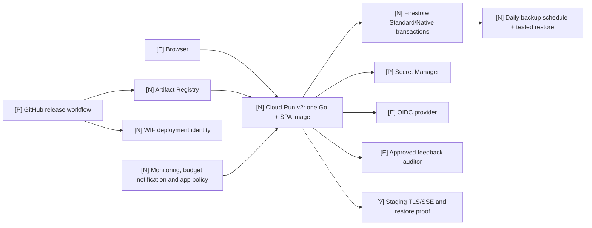

# Target architecture and rationale

**Target:** the smallest safe Google Cloud beta. Legend: `[I]` existing, `[P]` partial, `[N]` proposed, `[E]` external, `[?]` requires live verification. These are design recommendations, not deployed resources. Accepted 2026-11-02; the buildable detail is in [cloud-beta-design.md](../../specs/008-cloud-beta-deployment/cloud-beta-design.md).

## Design decisions

1. Keep one Go service and packaged SPA/lessons. Firestore Standard edition in Native mode is the proposed durable store, with transactions covering seat limits, invite use, sessions, audit ordering and spend reservations. Test the `state.Store` contract against both backends. Avoid simply copying the whole JSON blob into one Firestore document; document size, hot writes and transaction contention would defeat scale-out.
2. **Owner decision:** the staging environment is the initial invite-only beta demo app. Build the beta in that environment with dedicated runtime/deploy identities, WIF restricted to repository and staging environment, Secret Manager references, immutable image digests, and release tags. Secret values stay out of Terraform state. A separate, fully isolated production environment is a **GA milestone**, not a prerequisite for this beta.
3. Cloud Run service minimum instances 0 and a deliberately small maximum; size CPU, memory and concurrency after measured load. Deploy a [no-traffic tagged revision](https://docs.cloud.google.com/run/docs/rollouts-rollbacks-traffic-migration) in staging, smoke test its URL, then move **beta demo** traffic after approval. Record the previous staging revision for one-step rollback. Configure a startup probe whose success means the app can actually serve requests; Cloud Run [may route once startup succeeds](https://docs.cloud.google.com/run/docs/configuring/healthchecks).
4. Use Firestore daily scheduled backups and restore into a separate database during drills. Choose retention and recovery objectives with the owner. Backups include sensitive account hashes and feedback, so restrict access.
5. Package required images with the release, then use a self-origin CSP. Keep the tutor disabled in the beta. A future tutor policy module can enforce a persisted, fail-closed cutoff and authorized reset; billing notifications alone are too delayed to enforce a hard ceiling.
6. Add request IDs, structured low-cardinality metrics and a small dashboard before tracing. The beta dashboard needs API request/error/p95, auth failures, Firestore latency/errors, SSE failures, release revision, instance count, and cost/budget status. Exclude credentials and learner text.

Cloud Run [supports zero minimum instances](https://docs.cloud.google.com/run/docs/configuring/min-instances). Firestore [supports daily scheduled backups and restore to a new database](https://docs.cloud.google.com/firestore/native/docs/backups). Google states that [budget alerts do not automatically cap spending](https://docs.cloud.google.com/billing/docs/how-to/budgets).

**Future AI modules:** Keep tutor orchestration, provider gateway, approved-content retrieval, learner progress and safety/cost policy as modules of this service initially. Introduce a vector index or separate service only after a measured retrieval need, approved content policy, child-data design and cost case. Learner progress currently stays browser-local under DC-09; moving it server-side requires a constitution/spec decision first.
