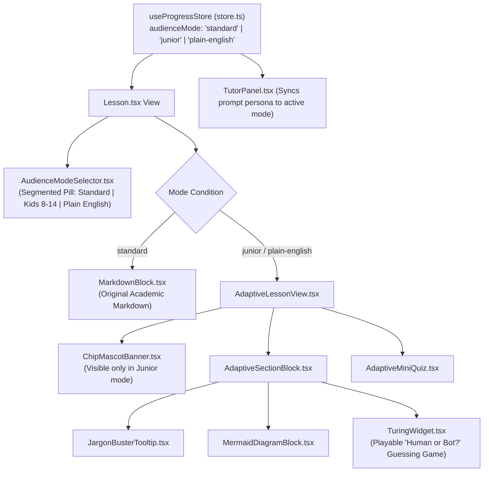
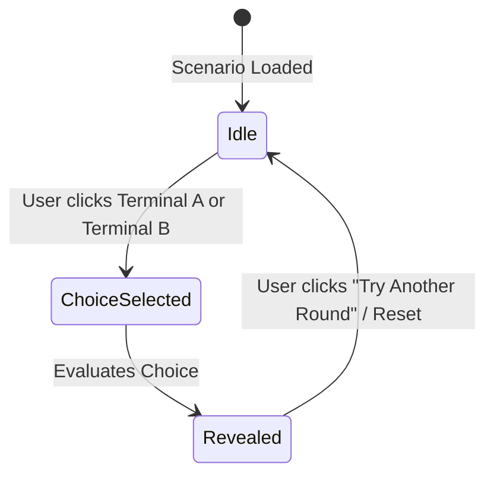

# Technical UI Implementation Plan: Adaptive Audience Modes

**Feature ID**: `PLAN-UI-002-ADAPTIVE`  
**Linked Spec**: [specs/pilot-lesson-1-adaptive-mode.md](file:///Users/santoshsharma/Documents/code/SDD-Training/specs/pilot-lesson-1-adaptive-mode.md)  
**Target Codebase**: React 18 + TypeScript + Vite + TailwindCSS (`AI Learning Mod/web/`)  
**Status**: Ready for Review  

---

## 1. Architectural Summary & Component Tree

The UI architecture extends the existing `Lesson.tsx` view with a reactive **Audience Mode Layer**. The canonical layout remains completely intact when in `standard` mode, while activating `junior` or `plain-english` swaps the content projection to the adaptive renderer.



---

## 2. Component Design Specifications

### 2.1 `AudienceModeSelector.tsx`
- **Location**: Top of the lesson content card, directly above the title.
- **Visual Design**:
  - A 3-option rounded pill container (`bg-slate-100 dark:bg-slate-800 p-1 rounded-xl inline-flex`).
  - Active button highlighted with an elevated white card (`bg-white dark:bg-slate-700 shadow-sm rounded-lg font-semibold text-blue-600 dark:text-blue-400`).
  - Smooth 150ms CSS transition on pill slider.
- **States & Labels**:
  1. `standard`: `🎓 Standard`
  2. `junior`: `🚀 Kids (8–14)`
  3. `plain-english`: `💡 Plain English`
- **Accessibility**:
  - Role: `role="tablist"` with `aria-selected` on active mode.
  - Full keyboard arrow key navigation (`ArrowLeft` / `ArrowRight`).

---

### 2.2 `ChipMascotBanner.tsx` (Junior Mode Only)
- **Role**: Friendly visual anchor and guide for young learners.
- **Visual Hierarchy**:
  - High-engagement card with light amber/yellow gradient border (`border-amber-200 bg-amber-50/60 dark:bg-amber-950/20`).
  - Mascot Avatar: Playful robot face with animated blinking digital eyes (`animate-pulse`).
  - Speech Bubble: Chip's welcome message and catchphrase (*"Let's crack the code together!"*).
- **Inline Quotes**:
  - Preceding each major section, a mini "Chip's Clue" card provides a 1-sentence teaser.

---

### 2.3 `TuringWidget.tsx` (Interactive "Spot the Bot" Mini-Game)
- **Role**: Hands-on experiential learning of Alan Turing's Imitation Game.
- **Component State Machine**:



- **UI Layout**:
  1. **Prompt Banner**: Shows the simulated user question (e.g. *"What did you eat for breakfast today?"*).
  2. **Comparison Cards**:
     - `Terminal A`: Shows Dialogue A with a `[ Pick Terminal A ]` button.
     - `Terminal B`: Shows Dialogue B with a `[ Pick Terminal B ]` button.
  3. **Reveal Card**:
     - Green celebration banner if user guessed correctly: `🎉 Spot On! Terminal B was the AI!`.
     - Blue learning banner if fooled: `🤖 Fooled! Terminal B was actually the AI!`.
     - An **Educational Breakdown** explaining *why* (e.g., *"Terminal B lacked emotional nuance and gave textbook facts"*).

---

### 2.4 `JargonBusterTooltip.tsx`
- **Role**: Eliminate intimidating vocabulary for non-tech adults and kids without cluttering text.
- **Interaction**:
  - Dotted underline styling (`border-b border-dotted border-blue-500 cursor-help font-medium`).
  - Hover (desktop) or tap (mobile) opens an accessible tooltip popover.
  - Displays:
    - **Term Name** in bold.
    - **Plain English Meaning** (e.g., *"Algorithm = A step-by-step recipe a computer follows"*).

---

### 2.5 `TutorPanel.tsx` Persona Sync
- When opening the AI Assistant drawer:
  - If `audienceMode === 'junior'`: The chat header changes to **"Ask Chip the Robot"**, with avatar 🤖 and a friendly placeholder (*"Ask me anything! No question is too silly..."*).
  - If `audienceMode === 'plain-english'`: Header displays **"Plain English Assistant"**, with placeholder (*"Ask for a real-world example or plain explanation..."*).
  - The API request automatically injects `mode: audienceMode` into the POST payload to `http://localhost:8080/api/tutor/stream`.

---

## 3. State Management & API Contract (`store.ts` & `api.ts`)

### Store Extension (`web/src/store.ts`)
```typescript
export type AudienceMode = 'standard' | 'junior' | 'plain-english'

interface ProgressState {
  // Existing state...
  completedLessons: string[]
  theme: 'light' | 'dark'
  
  // New Audience Mode State:
  audienceMode: AudienceMode
  setAudienceMode: (mode: AudienceMode) => void
}
```
*Persistence*: Persisted in `localStorage` under key `ai-coach-audience-mode` so user choice is preserved across lesson navigation and page refreshes.

### API Layer Extension (`web/src/api.ts`)
```typescript
export async function fetchAdaptiveLesson(
  lessonId: string, 
  mode: AudienceMode
): Promise<AdaptiveLessonPayload | null> {
  if (mode === 'standard') return null // Fallback to canonical markdown
  
  const res = await fetch(`/content/lessons/${lessonId}.${mode}.json`)
  if (!res.ok) throw new Error(`Adaptive content not found for mode ${mode}`)
  return res.json()
}
```

---

## 4. Phased Implementation Roadmap

| Phase | Deliverable | Verification Gate |
| :--- | :--- | :--- |
| **Phase 1: State & Selector** | Add `audienceMode` to Zustand store; build `AudienceModeSelector.tsx`. | Unit test: switching mode updates state and persists to `localStorage`. |
| **Phase 2: Adaptive View & Chip** | Build `AdaptiveLessonView.tsx` and `ChipMascotBanner.tsx`; link `1-intro.junior.json`. | Visual review: clicking "Kids" loads Chip banner and Grade 6 content in `< 50ms`. |
| **Phase 3: Interactive Turing Widget** | Build `TuringWidget.tsx` with dual-terminal cards, selection buttons, and reveal states. | Interaction test: user can click terminal, view result, and reset round. |
| **Phase 4: Jargon Buster & Tutor Sync** | Implement `JargonBusterTooltip.tsx` and propagate mode to `TutorPanel.tsx`. | E2E verification: AI Tutor answers in Chip's voice when in Junior mode. |
