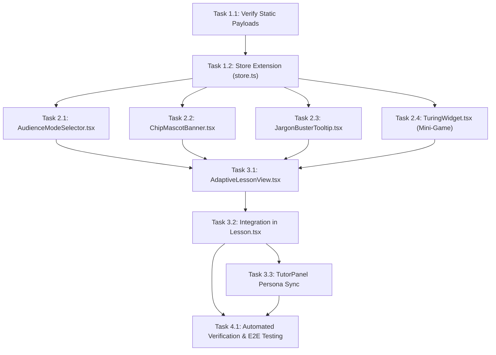

# Tasks Breakdown: Pilot Lesson 1 Adaptive Audience Modes

**Feature ID**: `TASKS-002-ADAPTIVE`  
**Branch**: `feature/v3.1-adaptive-modes`  
**Linked Spec**: [spec.md](spec.md)  
**Linked Plan**: [plan.md](plan.md)  
**Status**: Ready for Execution  

---

## Task Dependency Graph

---

## Phase 1: State & Payload Foundation

- [x] **Task 1.1**: Deploy Pilot Content Payloads
  - **Action**: Place `1-intro.junior.json` and `1-intro.plain-english.json` in `public-content/lessons/` (and ensure static file serving route resolves at `/content/lessons/1-intro.{mode}.json`).
  - **Verification**: `curl -I http://localhost:8080/content/lessons/1-intro.junior.json` returns `200 OK`.

- [x] **Task 1.2**: Extend Zustand Store (`web/src/store.ts`)
  - **Action**: Add `AudienceMode = 'standard' | 'junior' | 'plain-english'` to state, with `setAudienceMode(mode)`. Persist in `localStorage` (`ai-coach-audience-mode`).
  - **Verification**: Unit test confirming mode updates and survives page reload simulation.

---

## Phase 2: Component Construction

- [x] **Task 2.1**: Build `AudienceModeSelector.tsx`
  - **Action**: Create accessible segmented pill toggle with options `🎓 Standard`, `🚀 Kids (8-14)`, `💡 Plain English`.
  - **Verification**: Clicking options triggers `setAudienceMode`. Keyboard arrow navigation works.

- [x] **Task 2.2**: Build `ChipMascotBanner.tsx`
  - **Action**: Create the robot mascot banner with animated eyes, Chip's welcome catchphrase (*"Let's crack the code together!"*), and reusable section quote callouts.
  - **Verification**: Component renders with cartoon robot avatar and speech bubble styling in amber theme.

- [x] **Task 2.3**: Build `JargonBusterTooltip.tsx`
  - **Action**: Create subtle dotted-underline terms that trigger popover explanations on hover/tap.
  - **Verification**: Hovering over "Algorithm" displays *"A step-by-step recipe a computer follows"*.

- [x] **Task 2.4**: Build `TuringWidget.tsx` (Interactive Guessing Game)
  - **Action**: Implement the dual-terminal scenario component (`Terminal A` vs `Terminal B`), prompt display, selection buttons, celebration/learning reveal, and round reset.
  - **Verification**: Clicking a terminal reveals whether it is AI or human with Alan Turing's conceptual takeaway.

---

## Phase 3: View Composition & AI Tutor Integration

- [x] **Task 3.1**: Build `AdaptiveLessonView.tsx`
  - **Action**: Compose the adaptive layout: Chip Banner (Junior only), structured section blocks with analogy cards, Mermaid diagrams, embedded Turing Widget, and the Mini-Quiz.
  - **Verification**: Component successfully renders both `1-intro.junior.json` and `1-intro.plain-english.json` without errors.

- [x] **Task 3.2**: Integrate into `Lesson.tsx`
  - **Action**: Place `AudienceModeSelector` in the header; conditionally render canonical `MarkdownBlock` if mode is `standard`, or `AdaptiveLessonView` if `junior`/`plain-english`.
  - **Verification**: Switching between Standard, Kids, and Plain English is instantaneous (< 50ms) without page refresh.

- [x] **Task 3.3**: Sync AI Tutor Persona (`TutorPanel.tsx`)
  - **Action**: Pass `audienceMode` in `/api/tutor/stream` request payload. Update panel header to "Ask Chip the Robot" in Junior mode.
  - **Verification**: AI tutor replies using Chip's friendly storytelling tone when Junior mode is selected.

---

## Phase 4: Verification, Audit & Definition of Done

- [x] **Task 4.1**: Readability & Schema Audit
  - **Action**: Execute `python3 scripts/audit_lesson.py` on both payloads to assert Flesch-Kincaid grade level constraints.
  - **Verification**: Zero schema errors; Grade level <= 6.5 for Junior.

- [x] **Task 4.2**: Browser Acceptance & Regression Test
  - **Action**: Test on desktop and mobile viewports. Verify theme compatibility (dark & light mode) and check that canonical lessons 2–7 still load normally in Standard mode.
  - **Verification**: All 38 existing acceptance criteria pass; zero regression.
