# Technical Architecture & Phased Execution Plan: SPEC-005

- **Specification Reference:** `specs/spec-v3.1-curriculum-audio-expansion.md`
- **Target Branch:** `feature/v3.1-curriculum-audio-expansion`
- **Estimated Phases:** 5 Phased Sprints

---

## 1. Technical Architecture

### 1.1 Audio Engine 2.0 (`web/src/services/speechEngine.ts`)

```typescript
export interface VoicePersona {
  id: 'chip' | 'nova' | 'alan'
  name: string
  description: string
  avatar: string
  pitch: number
  rate: number
  preferredVoiceNames: string[]
}

export const VOICE_PERSONAS: Record<string, VoicePersona> = {
  chip: {
    id: 'chip',
    name: 'Chip the Companion',
    description: 'Warm, upbeat, and encouraging robot friend for young explorers',
    avatar: '🤖',
    pitch: 1.15, // Warm lift without tinny distortion
    rate: 1.02,
    preferredVoiceNames: ['Google US English', 'Samantha', 'Victoria', 'Karen'],
  },
  nova: {
    id: 'nova',
    name: 'Nova the Storyteller',
    description: 'Expressive, engaging narrative voice with natural cadence',
    avatar: '🎙️',
    pitch: 1.0,
    rate: 0.96,
    preferredVoiceNames: ['Samantha', 'Google UK English Female', 'Serena', 'Natural'],
  },
  alan: {
    id: 'alan',
    name: 'Prof. Alan',
    description: 'Calm, articulate, and insightful guide for deep comprehension',
    avatar: '🎓',
    pitch: 0.97,
    rate: 0.98,
    preferredVoiceNames: ['Daniel', 'Google UK English Male', 'Oliver', 'Alex'],
  },
}
```

#### Audio Quality Enhancements:
1. **Async Voice Hydration:** Listen for `speechSynthesis.onvoiceschanged` and populate priority-ranked voices.
2. **Text Chunking with Breath Pauses:** Parse input text into sentence fragments ($< 160$ chars) bounded by punctuation. Speak sequentially to maintain natural inflection without browser thread stalling.
3. **Karaoke Highlighting via `onboundary`:**
   - Track `event.charIndex` and broadcast active word/sentence position to subscribers.
   - Text elements wrap words in indexed `<span>` tokens that highlight dynamically during active playback.
4. **Musical Acoustic Feedback (Web Audio API):**
   - Synthesize chords via harmonic oscillator stacks:
     - *Success / Correct:* C5 (523.25Hz), E5 (659.25Hz), G5 (783.99Hz) in staggered 40ms arpeggio with soft cosine fade-out.
     - *Robot Greeting:* Friendly pentatonic chirp (D5 -> A5 -> F#5).
     - *Gentle Tap:* 600Hz filtered warm blip.

---

### 1.2 Curriculum Data Expansion Plan (Lessons 2–6)

Each lesson payload will follow the ratified schema:
- `lessonId`: string
- `mode`: `"junior"` | `"plain-english"`
- `title`: string (engaging title)
- `readingTimeMinutes`: number
- `mascot`: `{ name, avatar, greeting }` (for junior)
- `intro`: string (for plain-english)
- `sections`: Array of:
  - `id`: string
  - `heading`: string
  - `chipQuote`: string (junior only)
  - `analogy`: `{ metaphorName, description }`
  - `bodyMarkdown`: string
  - `diagram`: `{ type: "mermaid", caption, content }`
  - `interactiveWidget`: widget payload definition
  - `jargonBuster`: Array of `{ term, simpleExplanation, pronunciation? }`
- `miniQuiz`: Array of 3 comprehensive check questions with praises and explanations.

---

### 1.3 Interactive Simulation Widgets Specification

#### 1. Lesson 2: Expert System Decision Tree Simulator (`ExpertSystemWidget.tsx`)
- **Theme:** "Diagnose the Mars Rover Glitch"
- **Mechanics:** 
  - 3 input toggles (e.g., Solar Panels: Dirty/Clean, Battery: High/Low, Antenna: Aligned/Misaligned).
  - Visual decision tree highlighting active rule evaluation paths in real-time.
  - Interactive "Add a Rule" simulator illustrating symbolic forward-chaining.

#### 2. Lesson 3: Interactive Single Perceptron Playground (`PerceptronWidget.tsx`)
- **Theme:** "Train a Single Neuron to Classify Fruit"
- **Mechanics:**
  - 2 inputs: $x_1$ (Sweetness), $x_2$ (Crunchiness).
  - 2 draggable weight sliders: $w_1, w_2$ and Bias slider $b$.
  - Output calculation: $\sum (w_i x_i) + b \ge 0 \implies \text{Apple vs Orange}$.
  - Real-time 2D decision boundary line rendering.

#### 3. Lesson 4: Computer Vision Convolution Filter Explorer (`ConvolutionWidget.tsx`)
- **Theme:** "Robot Vision: Finding Edges in a Photo"
- **Mechanics:**
  - 5x5 or 7x7 interactive pixel grid (or preset icons: house, cat, letter 'A').
  - 3x3 filter kernel presets: **Edge Detect**, **Sharpen**, **Blur**, **Emboss**.
  - Animated sliding window showing element-wise multiplication and resulting feature map.

#### 4. Lesson 5: NLP Word Vector Math Playground (`VectorMathWidget.tsx`)
- **Theme:** "Word Constellations: Calculating with Meaning"
- **Mechanics:**
  - Interactive 2D semantic embedding scatter plot.
  - Equation builder: `[ King ] - [ Man ] + [ Woman ] = ?`
  - Learner selects vectors and watches the geometric vector addition glide to `[ Queen ]`.

#### 5. Lesson 6: Responsible AI Bias Detective (`BiasDetectiveWidget.tsx`)
- **Theme:** "The Job Hiring AI: Spotting the Unfair Filter"
- **Mechanics:**
  - Dataset card showing applicant resumes and historical approval rates.
  - Interactive demographic audit slider: test what happens when training data has an 80/20 skew.
  - Actionable fix toggle: "Data Balancing & Fairness Calibration".

---

## 2. Step-by-Step Execution Plan

```mermaid
gantt
    title SPEC-005 Execution Roadmap
    dateFormat  X
    axisFormat  Day %d
    section Phase 1: High-Fi Audio
    Async Voice Engine & Personas       :p1_1, 0, 1d
    Karaoke Real-Time Highlighting      :p1_2, after p1_1, 1d
    Sticky Audio Player & Voice Modal   :p1_3, after p1_2, 1d
    section Phase 2: Lessons 2 & 3
    Lesson 2 Payloads & Expert System   :p2_1, after p1_3, 1d
    Lesson 3 Payloads & Perceptron      :p2_2, after p2_1, 1d
    section Phase 3: Lessons 4, 5 & 6
    Lesson 4 Payloads & Convolution     :p3_1, after p2_2, 1d
    Lesson 5 Payloads & Vector Math     :p3_2, after p3_1, 1d
    Lesson 6 Payloads & Bias Detective  :p3_3, after p3_2, 1d
    section Phase 4: Multi-Modal Tools
    Voice Q&A (Talk to Chip STT)        :p4_1, after p3_3, 1d
    Jargon Pronunciation Audio Chips    :p4_2, after p4_1, 1d
    section Phase 5: Verification Gate
    Readability Audits (textstat)       :p5_1, after p4_2, 1d
    Playwright E2E Suite (All Widgets)  :p5_2, after p5_1, 1d
    Vite Production Bundle & Go Tests   :p5_3, after p5_2, 1d
```



---

## 3. Verification & Quality Gates

1. **Content Readability Quality Gate:**
   - Run `python scripts/audit_lesson.py` on all 10 new lesson JSON files.
   - Junior mode: Flesch-Kincaid Grade Level $\le 7.0$, Reading Ease $\ge 75.0$.
   - Plain English mode: Flesch-Kincaid Grade Level $\le 9.5$, Reading Ease $\ge 60.0$.
2. **Playwright E2E Test Suite:**
   - Verify every interactive widget mounts, responds to touch/click, and displays accurate visual output.
   - Verify voice switcher updates personas and triggers proper audio playback without crashes.
   - Verify karaoke span highlighting activates when audio is in flight.
3. **Performance & Bundle Budget:**
   - Zero external audio binary assets.
   - Vite bundle build executes cleanly under budget.
4. **Git Discipline:**
   - Strict adherence to Constitution Rule 10: `git add <file>`, no wildcard staging.
