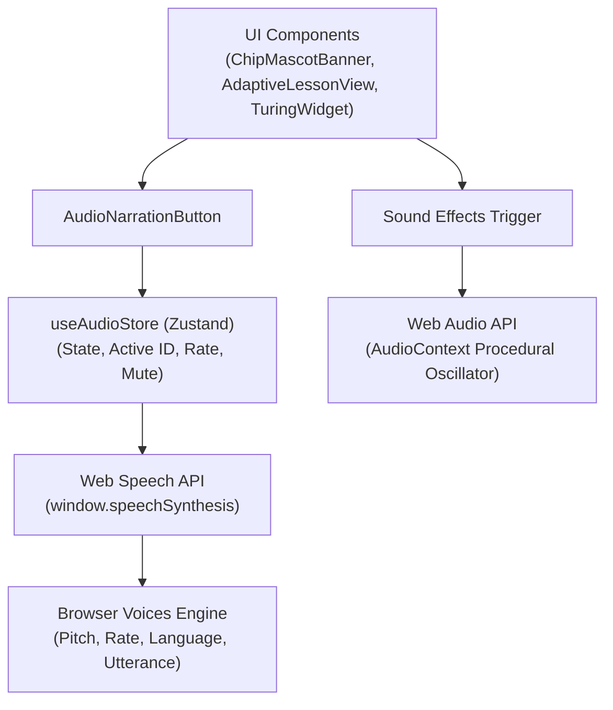

# SPEC-004: Interactive Audio Narration & Multi-Modal Learning Features (v3.0.1-2)

- **Feature Branch:** `feature/v3.0.1-2`
- **Target Release:** `v3.0.1-2`
- **Specification ID:** `SPEC-004-AUDIO`
- **Status:** Ratified / Implementing
- **Authors:** AI Foundations Coach Engineering & Antigravity Pair
- **Compliance:** Aligns with Constitution Rules DC-01..11, WCAG 2.1 AA Accessibility, and Zero-Asset-Bloat.

---

## 1. Executive Summary

Version **v3.0.1-2** extends the adaptive learning platform by adding rich, zero-latency **Audio Narration** and laying down the architectural blueprint for advanced multi-modal interactive features. 

To maintain constitutional compliance (no heavy database or large static binary asset bloat), all voice narration is powered client-side via the standards-compliant **Web Speech API (`window.speechSynthesis`)**, augmented by real-time parametric audio synthesis (**Web Audio API**) for delightful, lightweight acoustic feedback.

---

## 2. User Stories & Acceptance Criteria

### US-AUD-01: "Listen to Chip!" Mascot Audio Narration (Junior / Kids Mode)
- **As a** young learner (age 8–14) exploring AI Foundations,
- **I want** Chip the Robot to read his greetings, analogies, and lesson takeaways out loud in a cheerful robotic tone,
- **So that** learning feels like an interactive cartoon story rather than a dry textbook.
- **Acceptance Criteria:**
  - `AC-AUD-01.1`: In Junior mode, `ChipMascotBanner` displays a high-visibility `"Listen to Chip! 🔊"` button with soundwave animation.
  - `AC-AUD-01.2`: Clicking triggers synthesized speech with pitch raised (`pitch = 1.35`) and energetic rate (`rate = 1.05`).
  - `AC-AUD-01.3`: Clicking again stops speech immediately.

### US-AUD-02: Section-Level Read-Aloud (All Audience Modes)
- **As a** learner in Plain English, Junior, or Standard mode,
- **I want** an accessible audio narration button on every section card,
- **So that** I can listen to complex definitions and historical context while reading.
- **Acceptance Criteria:**
  - `AC-AUD-02.1`: Every lesson section header features an `AudioNarrationButton`.
  - `AC-AUD-02.2`: Standard mode uses natural neutral speech (`pitch = 1.0`, `rate = 1.0`).
  - `AC-AUD-02.3`: Plain English mode uses measured, clear pacing (`pitch = 1.0`, `rate = 0.95`).
  - `AC-AUD-02.4`: Only one section narrates at a time (starting a new section automatically cancels previous audio).

### US-AUD-03: Audio State Management & Controls
- **As a** user who may be in a library or public space,
- **I want** to easily pause, resume, cancel, or mute audio at any time,
- **So that** audio playback is always under my control.
- **Acceptance Criteria:**
  - `AC-AUD-03.1`: `useAudioStore` tracks playback state (`isPlaying`, `isPaused`, `currentSectionId`, `isMuted`, `rate`).
  - `AC-AUD-03.2`: Navigating away from the lesson or switching modes stops narration instantly.
  - `AC-AUD-03.3`: Global mute toggle available in top bar and settings.

### US-AUD-04: Procedural Sound Effects (Zero Binary Footprint)
- **As a** student playing the Turing Test widget or answering quizzes,
- **I want** subtle acoustic feedback on actions (correct answer chime, button tap),
- **So that** the application feels tactile and responsive without downloading megabytes of audio files.
- **Acceptance Criteria:**
  - `AC-AUD-04.1`: Sound effects generated on-the-fly via HTML5 `AudioContext` (sine wave oscillator chimes).
  - `AC-AUD-04.2`: Zero external `.mp3` or `.wav` files required.
  - `AC-AUD-04.3`: Sound effects respect the global mute setting.

---

## 3. Architecture & Technical Design

### Audio Services
1. `web/src/services/speechService.ts`:
   - `speak(text: string, options?: SpeechOptions)`: Wraps `SpeechSynthesisUtterance`.
   - `stop()`: Halts `window.speechSynthesis.cancel()`.
   - `pause()` & `resume()`.
   - `playChime(type: 'success' | 'click' | 'turing')`: Synthesizes pure Web Audio frequencies (e.g. C5 -> E5 -> G5 for success).
2. `web/src/stores/audioStore.ts`:
   - Zustand store with state persistence for audio preferences (`volume`, `muted`, `rate`).

---

## 4. Multi-Modal Feature Roadmap (Plan for More Improved Features)

| Feature | Target Version | Description | Technical Approach |
|---------|----------------|-------------|--------------------|
| **Voice Q&A for Tutor** | `v3.0.3` | Talk directly to the AI Tutor or Chip | Web Speech Recognition API (`webkitSpeechRecognition`) |
| **Jargon Pronunciation** | `v3.0.3` | Hear phonetic audio for AI terms | Tooltip speaker icon with phonetic speech synthesis |
| **Interactive Voice Quiz**| `v3.0.4` | Answer quiz questions by voice | Speech recognition match against quiz choices |
| **Multi-Lingual Audio** | `v3.0.5` | Voice narration in Spanish, French, Hindi | Automatic voice localization based on browser locale |
| **Full Audio Book Mode**| `v3.0.5` | Continuous autoplay across lesson sections | Sequential queue in `speechService` |

---

## 5. Verification Strategy
1. **TypeScript Typecheck & Build:** `npm --prefix web run build` (zero TS errors).
2. **Playwright E2E Tests:** `web/tests/audio-narration.spec.ts`:
   - Verify presence of audio buttons in Junior mode.
   - Verify click interaction toggles audio state and icon.
   - Verify mode switching resets audio.
   - Verify procedural audio context doesn't crash headless browsers.
3. **Backend API Stability:** Run Go test suite (`go test ./...`) to ensure 100% backward compatibility.
