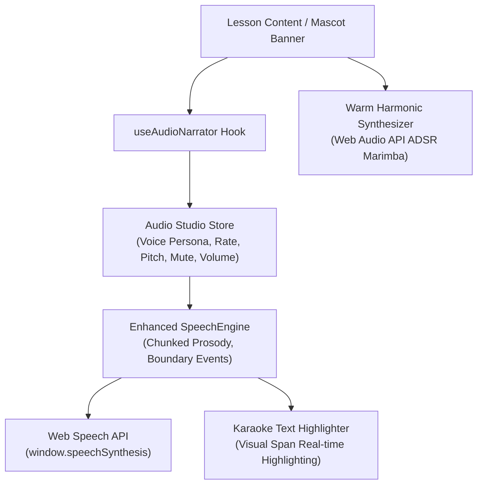

# SPEC-005: Full Curriculum Expansion (Lessons 1–6), High-Fidelity Audio Studio & Interactive Multi-Modal Learning (v3.1)

- **Feature Branch:** `feature/v3.1-full-curriculum-audio`
- **Specification ID:** `SPEC-005-CURRICULUM-AUDIO`
- **Target Release:** `v3.1.0`
- **Status:** Ratified / Planning
- **Constitutional Alignment:** DC-01..11, WCAG 2.1 AA Accessibility, Zero-Asset-Bloat (Procedural Audio + Web Speech API).

---

## 1. Executive Summary & Problem Statement

### The Problem
1. **Curriculum Coverage Gap:** Version `v3.0.1-2` successfully proved adaptive audience tracks (Junior / Plain English) and audio narration, but **only for Lesson 1**. Lessons 2 through 6 remain solely in technical canonical markdown, leaving a major content and interactivity void.
2. **Audio Tone Deficiencies ("Very Unappealing Tone"):** The initial prototype suffered from four acoustic issues:
   - Synchronous voice lookup picked stale fallback system voices (harsh, monotone, robotic).
   - Abrupt static pitch shifting (`pitch: 1.35`) produced tinny, piercing artifacts.
   - Monolithic text utterances lacked natural conversational punctuation pauses and breathing room.
   - Sound effects used rudimentary raw sine waves rather than warm, musical acoustic chords.
3. **Learner Engagement Opportunities:** Static reading can lead to cognitive fatigue. Learners need hands-on simulations for every AI concept, real-time karaoke text tracking, and voice interaction to make the curriculum world-class.

### The Solution
A comprehensive, end-to-end upgrade featuring:
- **Complete Lessons 1–6 Multi-Track Content:** 10 new curated JSON payloads with tailored analogies, Flesch-Kincaid audited reading levels, visual diagrams, and comprehension checks.
- **Dedicated Interactive Simulation Mini-Games for ALL 6 Lessons:**
  - *Lesson 1:* Spot the Bot (Turing Game) [Implemented]
  - *Lesson 2:* Symbolic AI Expert System Decision Tree Simulator
  - *Lesson 3:* Interactive Single Perceptron Playground (Draggable weights & threshold)
  - *Lesson 4:* Computer Vision 3x3 Convolution Kernel & Feature Map Explorer
  - *Lesson 5:* NLP Word Vector Math & 2D Semantic Distance Playground
  - *Lesson 6:* Responsible AI Bias Detective & Dataset Fairness Scanner
- **High-Fidelity Audio Studio Engine:**
  - Asynchronous natural voice discovery & ranking algorithm (prioritizing Apple Natural, Google US English, and Microsoft Neural voices).
  - Voice Persona Studio with 3 curated profiles: **Chip the Companion**, **Nova the Storyteller**, and **Prof. Alan**.
  - Natural prosody chunker with punctuation pacing.
  - Real-time **Karaoke Sentence & Word Highlighting** using `utterance.onboundary`.
  - Warm, pentatonic procedural chimes (ADSR envelope marimba harmonics).
- **High-Value Multi-Modal Additions:**
  - Speech-to-Text Voice Q&A ("Talk to Chip") via `webkitSpeechRecognition`.
  - One-click Jargon Audio Pronunciation chips.
  - Floating sticky audio controller with scrubber.

---

## 2. Curriculum Payload Specification (Lessons 1–6)

| # | Lesson ID | Canonical Title | Junior Title & Theme | Plain English Analogy | Interactive Simulation Mini-Game |
|---|-----------|-----------------|----------------------|-----------------------|-----------------------------------|
| **1** | `1-intro` | Introduction to AI | *Teaching Robots How to Think 🤖* | The Martian Puppy & The Chess Wizard | **Turing Test Interrogator** (Spot the bot behind the curtain) |
| **2** | `2-symbolic` | Knowledge Representation & Expert Systems | *The Giant Book of If-Then Rules 📜* | Flowcharts & Medical Diagnostic Trees | **Expert System Decision Tree Simulator** (Build rules to diagnose spaceship faults) |
| **3** | `3-neuralnetworks` | Introduction to Neural Networks | *Connecting the Brain's Spark Plugs ⚡* | The Orchestra Conductor & Dial Adjusters | **Interactive Perceptron Playground** (Tweak inputs & weights to fire the neuron) |
| **4** | `4-computervision` | Computer Vision & Convolution | *Giving Computers Robot Eyes 👁️* | Flashlight Grid & Cookie Cutter Patterns | **3x3 Convolution Kernel Explorer** (Apply edge detection & blur to images) |
| **5** | `5-nlp` | Natural Language Processing | *Teaching Computers the Power of Words 💬* | Word Maps & Meaning Constellations | **Vector Math Playground** ("King" - "Man" + "Woman" = "Queen" 2D scatter) |
| **6** | `7-ethics` | Ethical & Responsible AI | *Building Superpowers with a Moral Compass 🧭* | Skewed Camera Flash & Guardrails | **Bias Detective** (Audit training data balance & test algorithm fairness) |

---

## 3. High-Fidelity Audio Architecture

### 3.1 Audio Quality & Tone Improvements
1. **Asynchronous Voice Hydration (`onvoiceschanged`):** Eliminates stale synchronous lookups; guarantees highest quality neural/natural browser voice is pre-selected.
2. **Harmonic Voice Personas:**
   - **Chip (Kids Guide):** Pitch `1.15` (warm & upbeat without tinny squeak), Rate `1.02`, preferred voice: Natural female or youthful English.
   - **Nova (Storyteller):** Pitch `1.0`, Rate `0.95`, preferred voice: Deep, expressive narrative voice (e.g., Samantha, Daniel, Google US English).
   - **Prof. Alan (Academic):** Pitch `0.98`, Rate `1.0`, calm, measured, articulate cadence.
3. **Punctuation Cadence & Clause Segmentation:** Sentences are split on commas, em-dashes, and periods into natural acoustic breath groups, avoiding monotonous drone.
4. **Karaoke Real-Time Highlighting:** `utterance.onboundary` maps char offsets to section paragraphs, illuminating words/sentences in a soft golden glow as they are spoken.
5. **Warm Musical Chimes:** Replacement of harsh square/sine beeps with pentatonic harmonic intervals (C5 - E5 - G5 - B5) using smooth exponential decay envelopes (Attack 10ms, Decay 180ms, Release 200ms).

---

## 4. Multi-Modal Feature Enhancements

### Feature 1: "Talk to Chip" Voice Q&A (STT)
- Adds a microphone button to the Tutor input bar.
- Uses `webkitSpeechRecognition` / `SpeechRecognition` to transcribe learner queries directly into the tutor prompt.
- Chip automatically speaks the answer back in Junior mode!

### Feature 2: Interactive Jargon Pronunciation Chips
- Each term in the "Jargon Buster" grid receives a mini speaker button:
  `[ 🔊 Pronounce: "Stochastic" (stoh-KAS-tik) ]`
- Speaks the phonetic syllable breakdown followed by natural enunciation.

### Feature 3: Sticky Audio Mini-Player Bar
- When audio is playing, a slim, non-intrusive floating bar at the bottom provides:
  - Active Section Title
  - Play / Pause / Rewind 5s / Stop controls
  - Real-time progress bar
  - Persona quick-switch (Chip / Nova / Alan)

---

## 5. Phased Implementation Plan

- **Phase 1: Audio Engine Overhaul & Voice Studio**
  - Rewrite `speechService.ts` with async voice discovery, quality ranking, prosody chunking, and ADSR acoustic chimes.
  - Create `AudioSettingsModal.tsx` & floating `StickyAudioPlayer.tsx`.
  - Implement Karaoke highlighting in `AdaptiveLessonView.tsx`.
- **Phase 2: Lessons 2 & 3 Adaptive Payloads & Interactive Widgets**
  - Author `2-symbolic.junior.json` & `2-symbolic.plain-english.json` + `ExpertSystemWidget.tsx`.
  - Author `3-neuralnetworks.junior.json` & `3-neuralnetworks.plain-english.json` + `PerceptronWidget.tsx`.
- **Phase 3: Lessons 4, 5 & 6 Adaptive Payloads & Interactive Widgets**
  - Author `4-computervision.junior.json` & `plain-english.json` + `ConvolutionWidget.tsx`.
  - Author `5-nlp.junior.json` & `plain-english.json` + `VectorMathWidget.tsx`.
  - Author `7-ethics.junior.json` & `plain-english.json` + `BiasDetectiveWidget.tsx`.
- **Phase 4: Multi-Modal Additions ("Talk to Chip" Mic & Jargon Pronouncer)**
  - Integrate voice speech recognition into `TutorPanel.tsx`.
  - Add audio pronunciation to `JargonBusterTooltip.tsx`.
- **Phase 5: Automated Testing & Verification Gate**
  - Readability audits (`audit_lesson.py`) on all 10 new lesson files ($\le$ Grade 7 for Junior; $\le$ Grade 9 for Plain English).
  - Playwright E2E suite covering all 6 interactive widgets, voice controls, and audio playback.
  - Vite production bundle build & Go backend test validation.
